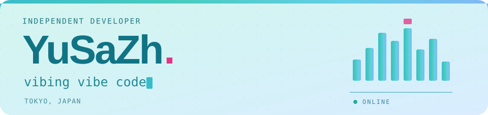

<!-- Original Miku animation above is intentionally preserved unchanged. -->

  

  
  
  

  <b>个人开发者 · Independent Developer</b> 
  东京 / Tokyo, Japan &nbsp; · &nbsp; ONLINE 
  Company / 公司：目前求职中 · Open to work  
  <samp>vibing vibe code</samp>

<!-- Additional personal details can be filled in later when confirmed. -->

<b>Languages</b>

  
  
  
  

<b>Web &amp; UI</b>

  
  
  
  

<b>Backend, Desktop &amp; Tools</b>

  
  
  
  
  

| Project | What it does |
| :--- | :--- |
| [**Imagine.**](https://github.com/YuSaZh/Imagine.) | Self-hosted AI image &amp; video workspace. TypeScript · React · Fastify · SQLite · Docker |
| [**MellowGrid**](https://github.com/YuSaZh/mellow-grid) | Visual Bento homepage builder with drag-and-drop layouts and HTML export. Astro · React · TypeScript · Tailwind CSS |
| [**BDSubMerge**](https://github.com/YuSaZh/BDSubMerge) | Desktop &amp; CLI tool for mapping episode subtitles onto Blu-ray MPLS timelines. Python · PySide6 / Qt |
| [**ChatGPT Toolkit**](https://github.com/YuSaZh/ChatGPT-Toolkit) | ChatGPT userscript with local usage estimates, message details and optional WebDAV sync. JavaScript · Node.js · Tampermonkey |
| [**Bilibili CDN Router**](https://github.com/YuSaZh/bilibili-cdn-router) | Automatic CDN fallback for Bilibili playback in mpv. Lua · mpv |

  
  

<samp>vibing vibe code ♫</samp>

<!-- Layout inspiration: https://github.com/ONLY-yours -->
<!-- Same capsule-render waving footer, recolored to water blue; license is embedded in the SVG. -->

